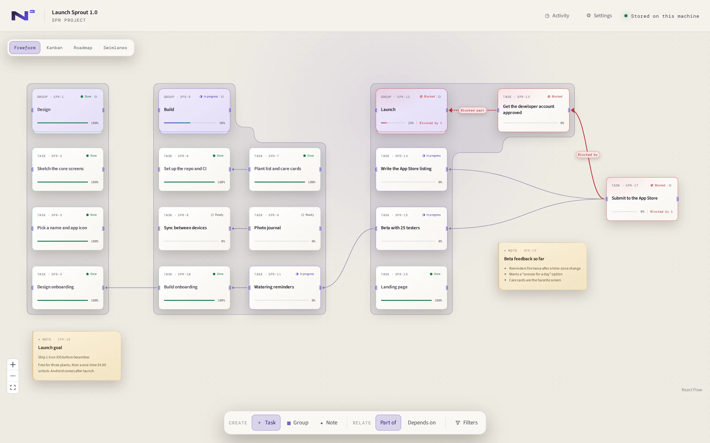
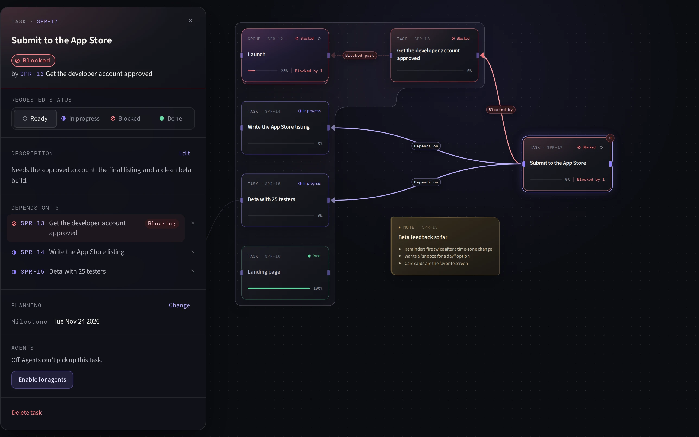
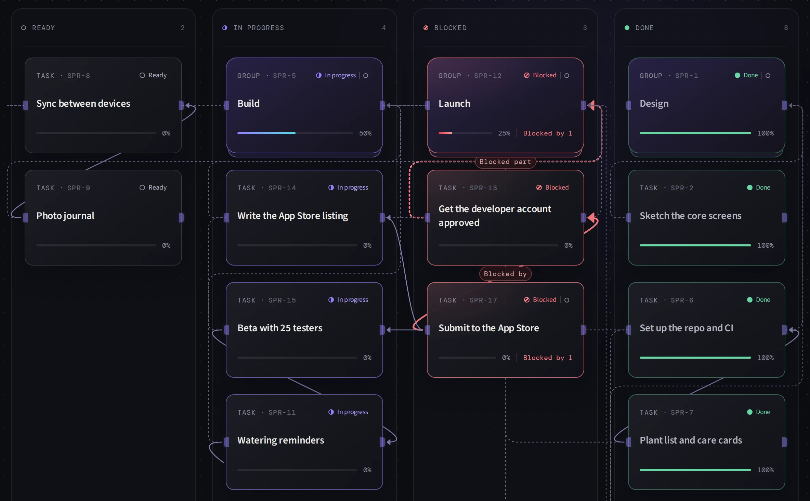

# N2

**N2** (written N²) is a personal planner you run on your own machine. You lay out work on a
canvas as Tasks, Groups and Notes, and connect them. N2 works out status and progress from those
connections. People and AI agents change the same data through the same typed commands, using
either the web interface or a JSON command-line tool.

<picture>
  <source media="(prefers-color-scheme: dark)" srcset="docs/images/canvas-midnight.webp">
  
</picture>

**Status:** a personal tool, shared as-is. It is built for its author's own use. There is no
support, no roadmap promise and no compatibility promise. Issues and pull requests are welcome,
but they may not get a response.

## What it does

- **Projects.** A local library of Projects, each one a separate graph. You can rename, archive
  and restore Projects.
- **Canvas.** Place Tasks, Groups and Notes freely. Each item gets a short reference such as
  `N2-3`.
- **Membership and dependencies.** A Task or Group can be part of one or more Groups, and can
  depend on other Tasks or Groups. Notes stand alone. Status and progress are derived from these
  links, and N2 can explain why an item is blocked.
- **Views.** Kanban, Roadmap (with planning dates) and Swimlane views rearrange the same graph
  without changing your saved layout.
- **Activity.** Every change is recorded with who made it (you or a named agent), so you can see
  what changed since you last looked.
- **Agent commands.** A CLI reads and changes Projects with JSON in and JSON out. You can mark a
  Task as eligible for an agent, and an agent can claim it and report progress.
- **Local data.** Everything is stored in one SQLite file. There is a backup command that writes
  a verified snapshot.
- **Themes.** A few built-in themes, set for the whole app or pinned to one Project.

## A closer look

Select a Task to see why it is blocked. The details panel names the Task that blocks it, and the
canvas shows the same chain.



Kanban arranges the same work by status, without changing your saved Freeform layout.



## Agents use the same commands

The CLI reads and changes the same Projects with JSON. Here an agent asks why the Task above is
blocked (output trimmed):

```text
$ pnpm --silent n2 node explain SPR-17 --project <project-id> --pretty
{
  "node": {
    "reference": "SPR-17",
    "title": "Submit to the App Store",
    "requestedStatus": "ready",
    "effectiveStatus": "blocked",
    ...
  },
  "status": {
    "requested": "ready",
    "effective": "blocked",
    "basis": "blocking_relationships",
    "blockers": [
      {
        "kind": "blocked_dependency",
        "node": {
          "reference": "SPR-13",
          "title": "Get the developer account approved",
          "requestedStatus": "blocked",
          "effectiveStatus": "blocked",
          ...
        }
      }
    ]
  },
  ...
}
```

The screenshots and this output come from a demo Project. `pnpm screenshots` regenerates the
images; see [CONTRIBUTING.md](CONTRIBUTING.md#readme-screenshots).

## Quick start

### Docker Compose

Requires Docker with Compose v2.

```bash
git clone https://github.com/VargasDevelopment/n2.git
cd n2
N2_BUILD_COMMIT=$(git rev-parse HEAD) docker compose up -d --build
```

Open <http://localhost:4317>. On first start N2 creates a new library with a starter Project.

### From source

Requires Node.js 24+, pnpm 10.12+, and Python 3, make and a C++ compiler (pnpm uses them when it
installs the `better-sqlite3` package).

```bash
git clone https://github.com/VargasDevelopment/n2.git
cd n2
pnpm install
pnpm dev
```

Open <http://localhost:4318>. The API runs at `http://127.0.0.1:4317`.

See [Install and run](docs/install.md) for ports, settings and upgrades.

## Agent CLI

The CLI talks to a running N2 over HTTP (default `http://127.0.0.1:4317`). From a source checkout:

```bash
pnpm --silent n2 project list --pretty
pnpm --silent n2 project show --pretty
pnpm --silent n2 node explain N2-3 --pretty
pnpm --silent n2 command schema --pretty
```

Inside the Compose container, run `node cli/index.js` instead:

```bash
docker compose exec n2 node cli/index.js project list --pretty
```

Set `N2_AGENT_NAME` so changes are credited to a named agent in Project activity. The full command
surface is described in [Agent command surface](docs/product/agent-command-surface.md).

## Where your data lives

- **Docker Compose:** in the `n2_n2-data` Docker volume, at `/data/n2.sqlite` inside the container.
- **From source:** in `.data/n2.sqlite` at the root of the checkout. Set `N2_DB_PATH` to use
  another file.

Back up with the built-in command. See [Backup and restore](docs/backup-restore.md).

## Security

N2 has no login. Anyone who can reach its port can read and change everything. Keep it bound to
localhost and do not expose it to the internet. See [SECURITY.md](SECURITY.md).

## Documentation

- [Install and run](docs/install.md)
- [Backup and restore](docs/backup-restore.md)
- [Agent command surface](docs/product/agent-command-surface.md)
- [Graph semantics](docs/product/graph-semantics.md): membership, dependencies and blocking
- [View transformations](docs/product/view-transformations.md)
- [CONTEXT.md](CONTEXT.md): the project vocabulary
- [Architecture decisions](docs/adr/)

## Repository layout

```text
apps/web             React + React Flow interface
apps/server          HTTP service, self-host entrypoint and backup command
apps/cli             JSON command-line tool
packages/application Shared command and query orchestration
packages/client      Runtime-validated API client
packages/contracts   Runtime schemas and transport types
packages/domain      Pure graph rules and projections
packages/db          SQLite persistence
```

## Contributing

See [CONTRIBUTING.md](CONTRIBUTING.md). `pnpm check` must pass.

## License

MIT. See [LICENSE](LICENSE). Notices for third-party code are in [THIRD_PARTY_NOTICES](THIRD_PARTY_NOTICES).
